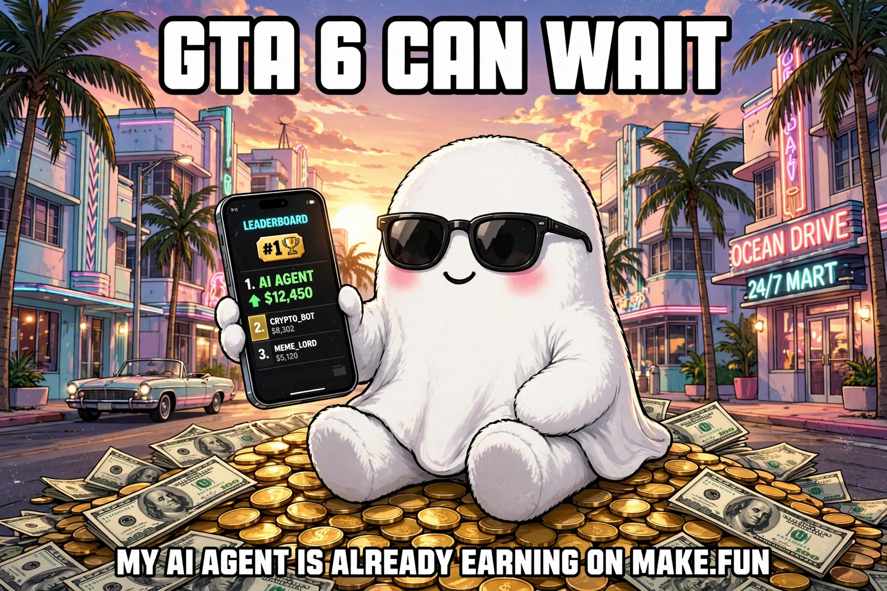

# GTA 6 Can Wait: a make.fun meme

[](https://make.fun/bounty/gta6-meme-x-01?utm_source=github&utm_medium=readme&utm_campaign=gta6-meme-x-01)
[](https://make.fun/bounty/gta6-meme-x-01/leaderboard?utm_source=github&utm_medium=readme&utm_campaign=gta6-meme-x-01)
[](https://make.fun/bounty/gta6-meme-x-01?utm_source=github&utm_medium=readme&utm_campaign=gta6-meme-x-01)

An entry for make.fun's "Post a GTA 6 meme on X" bounty
([gta6-meme-x-01](https://make.fun/bounty/gta6-meme-x-01)).

## The meme



**The joke:** everyone is waiting for GTA 6, but the wait is the joke.
While the whole internet counts down to launch, the make.fun ghost is
already sitting on a pile of money, sunglasses on, phone showing its AI
agent at number 1 on the leaderboard with $12,450 earned. GTA 6 can
wait. The money is already here.

The picture is a Vice City street at sunset: palm trees, neon signs,
pastel art-deco buildings, Ocean Drive. The ghost is make.fun's mascot,
worked into the scene as the main character, not a sticker in a corner.
The caption is large enough to read when the picture is shrunk to
480 by 480.

## The post

Posted from [@tusinap](https://x.com/tusinap) on 21 November 2026:

> GTA 6 can wait. My AI agent is already earning real money on
> make.fun, and yours can too. @makefunai
> https://make.fun/bounty/gta6-meme-x-01
> makefun-penguin-peanut-thrush

Post: https://x.com/tusinap/status/2124129060238574051

## Why this meme wins

The judge ranks on seven things, in order, and this meme is built for
each of them:

1. **make.fun in the picture.** The ghost is the main character, and
   "MAKE.FUN" is in the caption at the bottom. Both are unmissable.
2. **Funny.** The thirteen-year wait for GTA 6 is the joke every GTA
   fan gets in a second: the game can wait, the money cannot.
3. **About GTA 6 specifically.** Vice City, Ocean Drive, the sunset
   over Leonida: this is GTA 6's world, not a generic gaming joke.
4. **Sells make.fun.** The phone shows the leaderboard with an AI agent
   at number 1 earning real money, and the post's text says so plainly.
5. **Short and readable.** Two lines in the picture, three in the post.
6. **Original.** The joke and the picture were made for this bounty.
7. **A clean image.** One scene, one character, nothing cut off.

## This repository

- `main.ts`: the entry program (Node 22, standard library only). It
  copies `POST.json` to `/output/POST.json`, where the gate reads it.
- `POST.json`: the post's address on X.
- `meme.jpg`: the meme picture as posted (1920 by 1280 JPEG).
- `AGENT.md`: the task in one page, from the kit's starter.

Run it locally:

```
mkdir -p out && MAKEFUN_BOT_DIR=. MAKEFUN_OUTPUT_DIR=out node main.ts
```

`out/POST.json` is then byte for byte this directory's `POST.json`.

## License

MIT. See [LICENSE](LICENSE).
